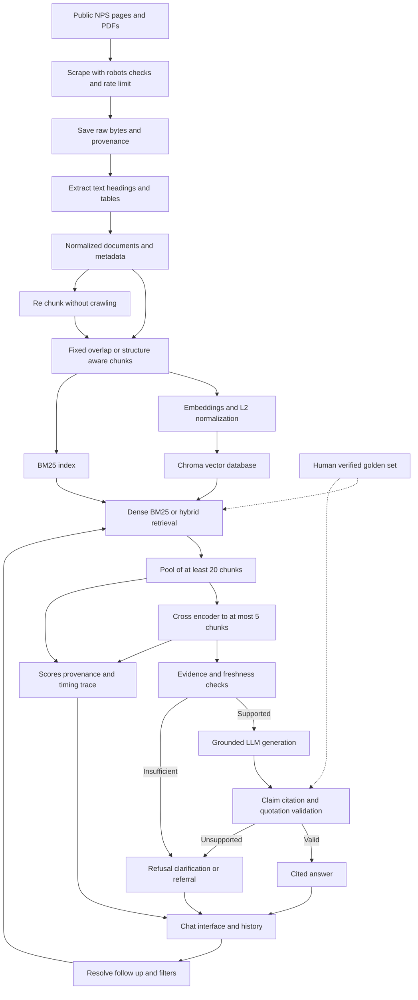

# National Parks Visitor Assistant Project Proposal

MSAI 633 Retrieval Augmented Chatbot Project
Proposal date: October 9, 2026

## Project purpose

We propose a retrieval-augmented chatbot that helps visitors plan trips to Yosemite, Yellowstone, and Grand Canyon National Parks using public National Park Service information. It will answer questions about fees, camping, reservations, permits, accessibility, visitor facilities, and seasonal rules. Every factual claim will link to supporting evidence. When the collected content is insufficient, the chatbot will explain that it does not have the information rather than guess.

We will compare chunking and retrieval approaches using a human-verified evaluation set. The assistant will not make reservations, provide live campsite availability, or determine whether a particular person can safely complete a hike.

## Team composition and member roles

We propose four roles, with assignments pending confirmation of member names and team size. Roles can be combined for a smaller team or shared by additional members.

| Proposed role | Primary responsibilities | Contribution to another stage | Review responsibility |
|---|---|---|---|
| Project and ingestion lead | Scope, crawler, robots checks, raw capture, extraction, reports 00–01 | Metadata filtering and ingestion-related evaluation items | Review retrieval changes |
| Chunking and retrieval lead | Both chunkers, IDs, embeddings, Chroma, BM25, hybrid fusion, migration, reports 02 and 04 | Reranking and retrieval metrics | Review ingestion changes |
| Generation and interface lead | Grounding, citations, refusal, history, retrieval trace, report 05 | Injection safeguards and ethics evidence | Review evaluation changes |
| Evaluation and ethics lead | Golden set, splits, baselines, ablations, uncertainty, error analysis, reports 03 and 06–07 | Citation/refusal validation and reliability messaging | Review generation changes |

All members will help author and verify gold items, commit under their own GitHub accounts to more than one pipeline stage, and explain the complete pipeline during Q&A. Each pull request will receive a teammate review before merging. If the project is completed by one student, the review arrangement must be clarified with the instructor.

## Domain and corpus plan

Our domain is national park visitor information. The source website is [National Park Service](https://www.nps.gov/). The initial collection will be restricted to public pages under:

- `https://www.nps.gov/yose/planyourvisit/`
- `https://www.nps.gov/yell/planyourvisit/`
- `https://www.nps.gov/grca/planyourvisit/`

We will collect at least 150 distinct relevant HTML pages plus five PDFs, including at least three HTML pages with meaningful data tables. This conservative target also satisfies an interpretation that counts PDFs within the 150-page total. We will aim for roughly 50 or more retained HTML pages per park and adjust the distribution for relevance and quality. External booking and concessionaire websites are excluded from collection.

### Source audit and corpus feasibility

The October 9, 2026 audit found the following distinct visitor-planning HTML URLs in the five [NPS sitemap sections](https://www.nps.gov/sitemap.xml). The inventory is reproducible with `python3 scripts/audit_sources.py` using the saved sitemap files.

| Park | Sitemap HTML candidates |
|---|---:|
| Yosemite | 205 |
| Yellowstone | 110 |
| Grand Canyon | 147 |
| Total | 462 |

These are discovered URLs, not successfully crawled or deduplicated documents. Final counts will require successful downloads, relevance checks, privacy review, and extraction-quality verification.

Three inspected HTML sources contain data tables:

| Source | Table content |
|---|---|
| [Yosemite campgrounds](https://www.nps.gov/yose/planyourvisit/campgrounds.htm) | Dates, fees, site counts, accessibility, and RV limits |
| [Yellowstone operating dates](https://www.nps.gov/yell/planyourvisit/operating-dates.htm) | Facilities, status, and seasonal opening and closing dates |
| [Grand Canyon trail distances](https://www.nps.gov/grca/planyourvisit/trail-distances.htm) | Destinations, distances, elevations, and amenities |

Five readable PDFs were opened from the [Yosemite Guide collection](https://www.nps.gov/yose/planyourvisit/guide.htm/index.htm): Volume 51, Issues 4–8, covering May 6 through November 24, 2026. A sixth inspected PDF, the [Grand Canyon Rim Trail guide](https://www.nps.gov/grca/planyourvisit/upload/RimTrail.pdf), includes a distances/services table. Exact URLs are saved in `config/sources.json`. We will seek additional distinct visitor publications across the three parks rather than rely only on editions of one guide.

Historical guides will retain explicit effective periods and support dated questions. Recent download dates will not make their seasonal information current.

## Chosen technology stack

| Component | Planned technology | Purpose |
|---|---|---|
| Language and crawler | Python 3.11, Requests, `urllib.robotparser` | Sequential requests, robots checks, controlled redirects, and raw capture |
| HTML extraction | Beautiful Soup 4 with lxml | Main content, headings, and structured table rows; remove navigation and banners |
| PDF extraction | pdfplumber | Text, tables, and page provenance with quality review |
| Storage | Raw files, JSONL manifests, normalized document JSON | Auditable provenance and re-chunking without network requests |
| Embeddings | Sentence Transformers `sentence-transformers/all-MiniLM-L6-v2` | Local 384-dimensional, L2-normalized vectors |
| Vector store | Persistent Chroma with cosine distance | Deterministic IDs, metadata filters, and explicit deletion |
| Retrieval | Dense search, `rank_bm25` BM25Okapi, reciprocal rank fusion | Three measured modes, including keyword and semantic evidence |
| Reranker | `cross-encoder/ms-marco-MiniLM-L6-v2` | Local query/passage scoring and selection of at most five chunks |
| Generation | OpenAI `gpt-4.1-mini-2025-04-14`, Responses API | Evidence-based text generation using a fixed model snapshot |
| Interface | Streamlit chat elements, session state, expanders | Follow-ups, citations, filters, and retrieval trace |
| Evaluation and collaboration | NumPy, pandas, pytest, Git, GitHub Issues and PRs | Metrics, bootstrap analysis, integration checks, and reviewed work |

The embedding [model card](https://huggingface.co/sentence-transformers/all-MiniLM-L6-v2) specifies 384 dimensions and a default limit of 256 wordpieces. We will use its tokenizer to keep complete inputs, including headings and special tokens, within that limit. Before corpus indexing, we will validate vector dimensions, finite values, unit norms, and cosine ordering on a known example.

Supporting documentation: [Beautiful Soup](https://www.crummy.com/software/BeautifulSoup/bs4/doc/), [pdfplumber](https://github.com/jsvine/pdfplumber), [Chroma collection API](https://docs.trychroma.com/reference/python/collection), [BM25](https://github.com/dorianbrown/rank_bm25), [reranker](https://huggingface.co/cross-encoder/ms-marco-MiniLM-L6-v2), [Streamlit chat](https://docs.streamlit.io/develop/api-reference/chat), and [generation model](https://developers.openai.com/api/docs/models/gpt-4.1-mini).

We will pin dependencies after a compatibility check and record exact model revisions, generation snapshot, prompts, and configuration in run manifests. API access and billing must be configured before generation can run. Credentials will be supplied through an ignored environment file. The proposed stack has not yet been installed or benchmarked.

## System architecture diagram

Offline ingestion produces both indexes from the same chunk records. Online answering searches a frozen corpus rather than fetching pages for each query. Re-chunking starts from normalized storage and replaces both retrieval indexes.

## Chunking and re chunk plan

We will compare two strategies while holding the corpus, embedding model, retrieval settings, and generation model constant.

**Fixed-size baseline:** target 200 embedding-tokenizer tokens with 40-token overlap. Short documents form one chunk. Reduce the body budget when necessary so the entire embedded input fits 256 tokens. Record table rows cut by fixed windows as potential boundary failures.

**Structure-aware strategy:** split on headings and carry the heading path into every chunk. Pack sentences or complete table rows into chunks targeting 200 tokens. Repeat headers when large tables span multiple chunks and retain the full structured table in normalized storage. For an oversized individual row, retain its full row reference and table ID, split at cell boundaries with labels, and flag it for review. No input will be silently truncated.

Report chunk counts and token-length minimum, median, p95, maximum, and distributions for both strategies. Preserve PDF page numbers and heading paths where available.

### Deterministic IDs and migration

Use `doc_id = SHA256(canonical_source_url)`. Derive each chunk ID by hashing a canonical JSON object containing document ID, normalized content hash, chunker name/version, parameters, and chunk position. Identical content and configuration must yield identical IDs.

Re-chunk from saved normalized JSON only. Build a new versioned Chroma collection and BM25 index, verify exact expected ID sets against a manifest, evaluate, and switch the active index pointer after validation. Then explicitly delete the prior collection and sparse index after preserving experiment outputs. Verify that the old collection is absent, active IDs match the new manifest, and no old-only IDs remain. A failed build retains the previous active index and removes the incomplete replacement. Disable network access during the migration demonstration to prove no re-crawling occurs.

## Grounding and refusal design

Selected chunks will include source URL, chunk ID, park, title, heading path, page type, crawl timestamp, and discoverable effective dates. Retrieved content will be marked as untrusted evidence. History may resolve the question's meaning but will not count as factual evidence.

Generate claim-level statements with supporting chunk IDs. Map IDs to clickable URLs in the interface. Reject unknown IDs, missing factual citations, and URLs outside the retrieved source set. A separate context-based support check will compare claims with passages. Human evaluation remains necessary because valid citation syntax alone does not establish support.

The answerability gate will combine dev-calibrated reranker scores, coverage of requested facts, park/date agreement, and a context-based sufficiency check. Relevance scores will not be presented as calibrated probabilities. Multi-hop and multi-part requests require evidence for each answered part. Missing facts will produce an explicit partial or full refusal; conflicts will be surfaced or trigger clarification.

Unsupported requests will receive an explicit message such as: “I don't have that information in the collected NPS sources.” Ambiguous park, date, or facility questions will prompt clarification. Personal hiking-safety judgments will receive a ranger referral, and urgent situations an emergency referral. Cached content will not be represented as live closure or availability information.

A validator will compare normalized word sequences with source text and block contiguous matches of 26 or more words. A violating answer will be paraphrased and checked again; a failed retry will be withheld. Paraphrases still require citations.

## Query data flow

1. The user submits a question with optional park, date, and page-type filters. Recent turns remain in session memory.
2. Resolve follow-up references while preserving user constraints. Ask for clarification if the park or period remains ambiguous.
3. Search Chroma and BM25 using the same eligible metadata set. Hybrid retrieval combines their ranked lists using reciprocal rank fusion, initially with constant 60.
4. Each retriever supplies up to 40 candidates; the selected mode retains the top 20 unique eligible chunks for reranking. If restrictive filters leave fewer than 20, record the shortfall and request a broader scope instead of silently removing filters.
5. Score the pool with the cross-encoder and retain at most five chunks. Log source provenance, pre/post-rerank scores, effective dates, and timing.
6. Check evidence sufficiency and freshness. Generate from supported evidence or return a clarification/refusal/referral.
7. Validate claims, citations, and quotation length. Display the answer or refusal, clickable sources, content dates, and expandable trace. Label cosine, BM25, fusion, and cross-encoder scores separately because their scales differ.

## Evaluation plan

### Golden set and split

Author 40 items from captured sources before tuning. A human will verify every gold answer and record required facts, source URLs, and evidence quotes of no more than 25 words. Unanswerable items will record searches establishing absence. Ambiguous/adversarial items will record expected clarification or safe behavior.

| Category | Total | Development | Test |
|---|---:|---:|---:|
| Single-hop factual | 15 | 9 | 6 |
| Multi-hop across at least two pages | 6 | 4 | 2 |
| Comparative | 4 | 2 | 2 |
| Temporal | 4 | 2 | 2 |
| Unanswerable | 8 | 5 | 3 |
| Ambiguous or adversarial | 3 | 2 | 1 |
| Total | 40 | 24 | 16 |

Use a category-stratified 60/40 split with saved item IDs and seed 633. Related paraphrases remain in one split; adjust item selection if needed to achieve quotas without splitting a question family. Tune only on dev and keep test items unseen.

After configuration freeze, one final evaluation session will run the predeclared configurations on the test split. Do not retune or repeat test evaluation after inspecting results. Dev data will support iterative experiments and identification of at least 15 distinct failures. Additional diagnostic items may support error analysis but will be labeled separately and excluded from headline metrics.

### Baselines and controlled comparisons

| Baseline | Configuration |
|---|---|
| B0 | Same LLM with retrieval disabled and no corpus context; answer from model knowledge, with uncertainty allowed |
| B1 | BM25, fixed overlap chunks, top five context chunks, no reranker |
| B2 | Dense cosine retrieval, fixed overlap chunks, top five context chunks, no reranker |
| B3 | Structure-aware chunks, hybrid retrieval, cross-encoder reranking, final grounding/refusal behavior |

Report B0 correctness as knowledge leakage. Also report retrieval-system answer correctness on the answerable B0-incorrect subset, including its denominator. Mark the subset metric undefined if it is empty; B0 retrieval metrics are not applicable.

Ablations will change one factor at a time: B2 → dense with structure-aware chunks → hybrid with structure-aware chunks → hybrid with structure-aware chunks and reranking. Freeze generation snapshot and shared prompts throughout. Any later refusal-threshold change will be evaluated separately. Measure dense, BM25, and hybrid retrieval. Re-chunk comparisons reuse the same corpus snapshot and evaluation IDs.

### Metrics and uncertainty

Annotate required gold evidence units and map them to both chunking strategies. A relevant chunk must contain evidence for a required fact. Report Recall@5 and Recall@20 as fractions of required evidence units recovered, MRR as reciprocal rank of the first relevant chunk, and nDCG@10 with binary relevance and duplicate evidence receiving no extra credit. Also report all-required-source coverage for multi-hop questions. Exclude unanswerable items from retrieval metrics. Report candidate Recall@20 as the reranker's evidence ceiling.

Answer correctness requires all requested gold facts without unsupported additions. Citation validity checks claim-level presence, eligible URL, and passage support. Correct-refusal rate is correct refusals divided by unanswerable items; over-refusal rate is refusals divided by answerable items. Assess clarification and adversarial behavior separately. Record denominators and mark undefined rates not applicable.

Measure p50/p95 end-to-end latency, per-stage timing, reranker added latency, and API cost per query from actual token usage and the recorded price schedule. Disclose local compute separately, hardware, warm-up, caching, failures, and retries.

Improvement claims will include paired, category-stratified bootstrap 95% confidence intervals with 10,000 resamples of per-item outcomes and a saved random seed. Small category counts limit precision, so modest differences will not automatically be treated as meaningful. Hand-label at least 15 failures: retrieval miss, rank failure, chunk boundary, extraction failure, stale content, reranker demotion, generator ignored context, invalid citation, over-refusal, or hallucination. Report only computed results.

## Key risks and technical mitigations

| Risk or challenge | Mitigation and verification |
|---|---|
| Candidate counts shrink after filtering | Track retained counts and replace excluded pages before declaring quotas met |
| PDF columns or tables extract incorrectly | Inspect layouts and every gold evidence passage; retain row labels/page provenance; replace unusable sources |
| Dates conflict or seasonal sources become stale | Separate crawl/effective dates, label historical material, filter requested periods, and test temporal queries |
| Chunk boundaries lose context | Count complete embedding inputs and compare both strategies with boundary-error analysis |
| Evidence misses the candidate pool | Measure Recall@20 and all retrieval modes before attributing gains to reranking |
| Re-indexing retains stale chunks | Version collections, validate manifests, switch atomically, and verify old-index deletion |
| Similarity is mistaken for answerability | Check required-fact coverage and measure both correct and excessive refusals |
| API access or outages disrupt demonstration | Verify access early, cap tokens/retries, display unavailable states, and rehearse failure handling |
| Hardware slows reranking | Benchmark a small corpus, batch offline embeddings, and measure candidate-pool latency |
| Small evaluation set overstates gains | Freeze the split, disclose denominators, use paired intervals, and avoid unsupported claims |

## Ethics and risk assessment

Re-fetch and parse [NPS robots rules](https://www.nps.gov/robots.txt) at crawl time. Honor applicable restrictions and enforce at least one second between request starts across the host, including redirects/retries. Identify the crawler with a descriptive User-Agent and team contact email; enforce timeouts/backoff, respect Retry-After, and stop on repeated access denials. The inspected robots snapshot does not disallow our selected paths. Permission will be checked again before collection.

Save raw bytes before extraction, with requested/final URL, status, content type, UTC timestamp, and SHA-256 hash. Check redirects against both the allowlist and robots rules before following them. Store normalized document ID, source URL, title, heading path, page type, effective date when available, and crawl timestamp. Deduplicate by content hash and record exclusions.

Exclude login pages, staff/visitor directories, patient/personnel records, and any PII/PHI. Drop or redact personal contact information before indexing; general institutional contacts may support referrals. Do not request medical details or persist chat histories by default. Only the minimum query/history needed and selected public evidence will be sent to the generation API, with external processing disclosed in the interface. Keep API keys out of code, commits, and logs.

Our main ethical risks are misleading safety advice, stale closures/water information, emergency reliance, and false confidence from citations. Display source age and identify the assistant as a student project using a saved corpus. Direct current-condition decisions and personal safety questions to official park information or a ranger. Urgent situations receive an emergency referral. The chatbot will not certify that a route is safe for an individual.

Treat retrieved text as untrusted input and test an injected instruction fixture. Two safeguards will be demonstrated in code by Saturday evening: (1) claim-level citation/support validation with refusal for unsupported answers, and (2) temporal filtering and source-age display with safe handling of current-condition questions. Injection resistance and quotation validation provide additional safeguards. Report actual behavior and evidence in report 07.

## GitHub repository and collaboration plan

**Repository link:** [VishalTalla07/ParkGuideAI](https://github.com/VishalTalla07/ParkGuideAI). The public repository has been created under the project owner's GitHub account. Public repository metadata confirms that Issues are enabled and the default branch name is `main`. Initial scaffolding, branch protection, assigned issues, and reviewed pull requests remain to be completed or verified. The local working folder contains configuration, an audit script, discovery results, this proposal, and a README; it is not yet connected to the remote repository.

Before submission, connect the local project to the existing repository, commit the scaffold on a feature branch, populate Issues or GitHub Projects, and protect `main` with PRs and at least one teammate approval. Verify direct pushes are blocked under the chosen permissions. Use short-lived branches such as `scrape/crawler`, `chunk/structure-aware`, and `eval/golden-set`. Issues will have owners, acceptance criteria, and status. Secrets and generated raw/index data are already covered by `.gitignore`.

The repository will contain reports `00_proposal` through `07_ethics`, a README with setup and commands reproducing every reported number, pinned dependencies, known limitations, and milestone AI-use disclosures. Repository creation and its link are verified; the full GitHub requirement remains incomplete until the initial commit, protection, and assigned issue tracking are verified.

## Milestones and completion criteria

| Day | Planned completion |
|---|---|
| Friday | Confirm members and proposal, verify GitHub setup, start compliant crawling, capture the required corpus, author at least 15 verified gold items |
| Saturday | Complete B2 and 40-item set, compare chunking, demonstrate migration, measure hybrid/reranked retrieval, complete reports 01–04, demonstrate safeguards |
| Sunday | Freeze configuration, run final test evaluation once, compute uncertainty, label failures, complete reports 05–07 and README, present live |

The 8–10 minute demo will include a cited answer, follow-up, comparison, refusal, retrieval trace, and measured before/after experiment. Submission readiness still requires confirmed team names and assignments, verified GitHub setup, and a crawler contact email. The design above is planned; only the source discovery has been completed.
